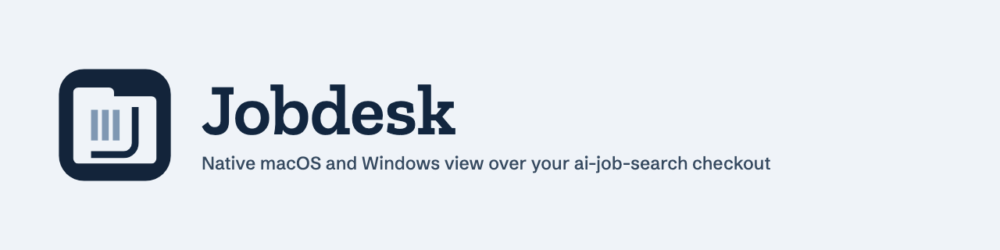

<h1>
  <picture>
    <source media="(prefers-color-scheme: dark)" srcset="assets/brand/jobdesk-banner-dark.png">
    
  </picture>
</h1>

Native macOS and Windows view over an [ai-job-search](https://github.com/ai-job-search-dev/ai-job-search) checkout, built with Rust and egui.

In-tray is the home screen: one queue of decisions, one card at a time, with paused runs first, then deadlines, then the rest. Y follows the suggestion, L sets the card aside until tomorrow, N skips, U undoes. Y opens the slash command in the launcher, and nothing runs until you start it. Permission, question and guard cards have no Y action. Skip reasons stay in the app's data folder.

In-tray, Jobs, Tracker and Insights update live as commands change your files. The Runs screen starts any slash command through your local `claude` CLI and shows its progress, permission requests, questions, cost and history.

Workspace shows whether your profile, tools, portals, templates and sync are ready.

Open an application from Tracker for its dossier: compiled PDFs, verification results, keyword coverage, evaluation, archived posting, prep packs, outcome notes and follow-up drafts. Verification, keywords and evaluation exist only in `/apply` output, so they appear for applications run through Jobdesk.

Jobdesk itself never writes to your checkout. Slash commands stay the only writers, and rules you allow "for this run" last for that session only. It stores no credentials and uses the login of your installed Claude CLI. Run logs, which include the text of your runs, and your tray decisions are kept in the app's data folder and are readable only by your user.

Only one run works at a time, because two commands could overwrite each other's files. A session waiting for your reply does not block a new run.

## Run

Needs Rust 1.95 or newer.

```bash
cargo run -- --workspace /path/to/ai-job-search
```

You can also set `JOBDESK_WORKSPACE`, or choose the folder in the app. It reopens the last folder.

## Package

```bash
cargo install cargo-packager --locked --version 0.11.8
```

```bash
cargo packager --release --formats app,dmg
```

Output lands in `target/packages`. On Windows use `--formats nsis`. `.github/workflows/build.yml` builds both platforms once the repo has a GitHub remote.

These builds are not signed with a developer identity. macOS and Windows warn on other machines until they are signed and notarized. The app icons live in `assets/brand/`.

## Authentication

Jobdesk runs your installed Claude Code CLI and uses the authentication you set up there. It is not made or endorsed by Anthropic. Read [docs/auth-review.md](docs/auth-review.md) before distributing it.

## Test

```bash
cargo test
```

A real Claude session runs only on request and costs a few cents:

```bash
cargo test --test live_claude -- --ignored --nocapture
```

Screen tests render every screen in both themes from `tests/sample_workspace`, which holds fictional data. After an intended visual change, refresh them:

```bash
UPDATE_SNAPSHOTS=1 cargo test --test screens
```

See [ARCHITECTURE.md](ARCHITECTURE.md) for the structure and the rules `tests/architecture.rs` enforces.
