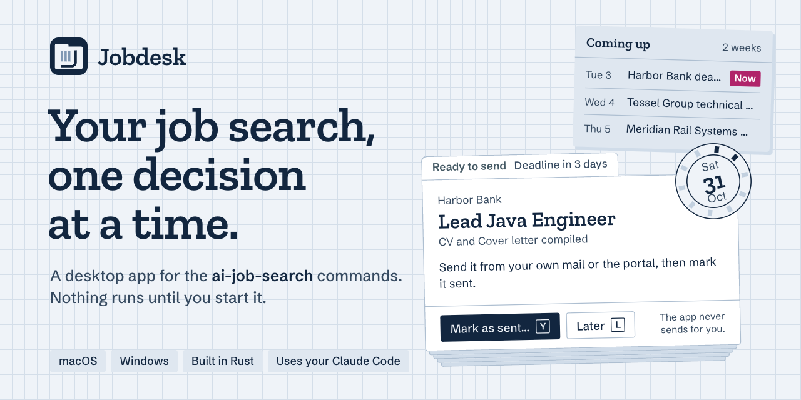
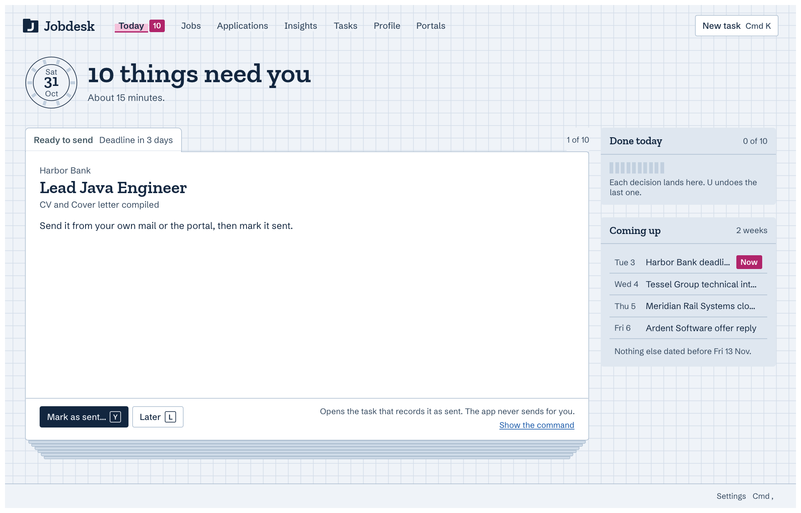

  

<h1 align="center">Jobdesk</h1>

Jobdesk is a native macOS and Windows app over the [ai-job-search](https://github.com/ai-job-search-dev/ai-job-search) slash commands, run through your own Claude Code CLI.

  
  
   
  <a href="https://nicolas-widart-srl.github.io/jobdesk/">Website</a> · <a href="https://github.com/Nicolas-Widart-SRL/jobdesk/releases">All releases</a>

## What it does

- **Today** deals your decisions one card at a time.
- **Jobs, Applications and Insights** update live as commands change your files.
- **Tasks** starts any slash command and shows its progress, Claude's questions and the cost.
- **Profile** shows and edits what Claude reads about you, and previews your CV PDFs.
- **Portals** turns the job boards Claude searches on or off, and installs or builds new ones.
- **Application dossiers** gather each application's PDFs, prep packs and follow-ups.
- **Settings** shows what tasks cost, and sets sign-in, a monthly cap, tool permissions and more.

  

## Install

You need the [Claude Code](https://code.claude.com/docs/en/overview) CLI, installed and signed in. On Windows, or with a folder you already have, an Anthropic Console API key saved in Settings › Providers can replace its sign-in.

- **macOS** can set up from scratch: Jobdesk makes the folder, downloads ai-job-search, and installs any missing Python, Bun or LaTeX in `~/.jobdesk`. See [First run](docs/guide.md#first-run).
- **Windows**, or a folder you already have, needs an [ai-job-search](https://github.com/ai-job-search-dev/ai-job-search) checkout.

Download the installer from the [latest release](https://github.com/Nicolas-Widart-SRL/jobdesk/releases/latest):

- **macOS** (Apple silicon): open `Jobdesk-vX.Y.Z-macos-arm64.dmg` and drag Jobdesk to Applications.
- **Windows**: run `Jobdesk-vX.Y.Z-windows-x64-setup.exe`.

If the system blocks the first open:

- **Windows** SmartScreen, as the installer is not signed yet: click More info, then Run anyway.
- **macOS**, for an ad-hoc-signed build from before signing or from the Installers workflow: try to open Jobdesk once, then click Open Anyway in System Settings › Privacy & Security.

Updates:

- The status bar tells you when a new version is out, and Restart to update installs it. A copy from before updates existed needs one install by hand.
- When you move from an ad-hoc-signed macOS copy, macOS may ask once for keychain access to a saved API key: choose Always Allow. If Restart to update cannot install the signed release, install it by hand.

## Privacy and trust

- **Nothing runs until you start it.**
- Slash commands write your checkout. Jobdesk itself writes it only in first-run setup (a new or empty folder, then your documents), a Profile save, a portal's On/Off switch or Remove (to the Trash, or the Recycle Bin on Windows) and the folder update.
- The folder update brings a folder Jobdesk set up the files for your Jobdesk. It keeps your file where you both changed the same lines, except in the two files that guard what Claude may do, and you can [undo it right after](docs/guide.md#updating-your-job-search-folder).
- Setup and the folder update check each download against Jobdesk's own record of it.
- **Tool permissions are allowed by default and listed in the activity, so a posting written to trick Claude could get a command run before you see it.** Settings › Permissions turns prompts on.
- The workspace checks postings with `posting_guard` before scoring them.
- Run logs, which hold the text of your runs, and your decisions stay in the app's data folder, readable only by your user.
- Jobdesk uses Claude Code's sign-in and keeps no password. An optional Console API key stays in the system keychain, Jobdesk passes it only to the Claude Code process of a task or of Test connection, and [Trust](docs/architecture/trust.md#the-api-key) says where it goes from there.
- Jobdesk checks GitHub for updates when it opens and about every 6 hours, sending only its version. Turn this off in Settings › About.
- Portals › Browse community reads the community portal list from GitHub, sending only Jobdesk's version.

Jobdesk is not made or endorsed by Anthropic.

## More

- [docs/guide.md](docs/guide.md): every screen in detail.
- [CONTRIBUTING.md](CONTRIBUTING.md): build, package, release and test.
- [ARCHITECTURE.md](ARCHITECTURE.md): how the code is structured.
- [CHANGELOG.md](CHANGELOG.md): what changed in each release.

## License

Jobdesk is released under the [MIT License](LICENSE).
